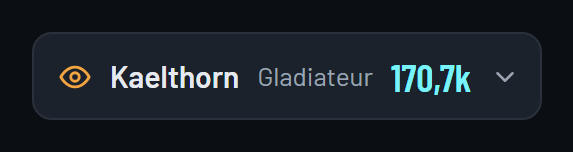
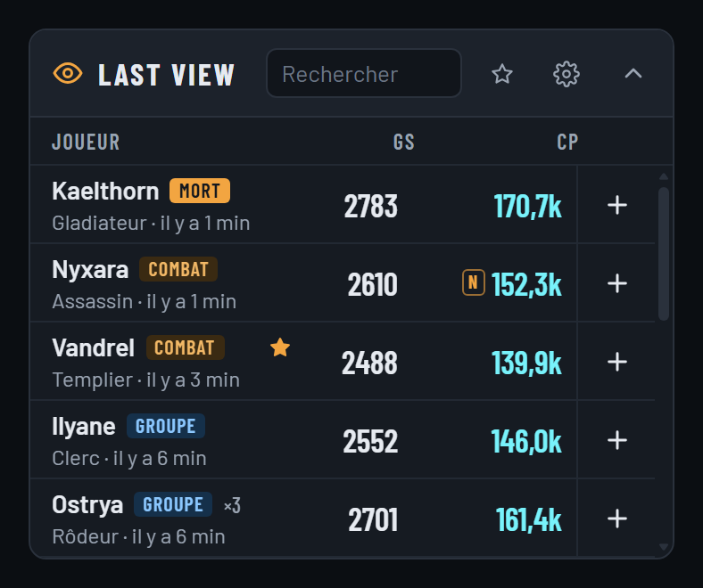

# LastView — Aion 2 Overlay

Overlay passif pour Aion 2 (Windows 11). Il affiche, par-dessus le jeu, le stuff réel des joueurs que vous rencontrez (ciblage, combat, kill, mort, groupe, buff), avec une fiche complète calquée sur shugo.gg.

> **Fan-made, non affilié à NCSOFT.** Projet personnel sous licence GPL-3.0. Aion 2 est une marque de NCSOFT.

<p>
  
</p>
<p>
  
</p>

*Captures du mode démo, avec des joueurs fictifs.*

## Ce que fait LastView

1. Il écoute passivement une copie du trafic réseau du jeu (Npcap). Jamais de lecture mémoire, d'injection ni d'envoi de paquets au jeu.
2. Il mémorise en silence les joueurs qui apparaissent autour de vous.
3. Dès qu'une rencontre réelle a lieu, le joueur apparaît en haut d'une petite bulle au-dessus du jeu : pseudo, classe, GS, CP.
4. Un clic sur « + » ouvre une fiche complète dans une fenêtre à part : équipement avec infobulles, compétences et stigmas, Daevanion, stats et titres.
5. L'historique est conservé 4 h (réglable) et survit à un redémarrage. Les joueurs épinglés restent.

Tout reste en local. Les seuls appels réseau sortants sont les lectures de l'API publique NCSoft (données de personnage) et GitHub (mise à jour).

## Installation

1. Installez [Npcap](https://npcap.com) s'il n'est pas déjà là (il l'est si vous utilisez déjà un DPS meter). À son installation, **laissez décochée** la case « Restrict Npcap driver's access to Administrators only ».
2. Téléchargez la dernière version dans les [Releases](https://github.com/urattems/lastview-aion2-overlay/releases/latest) :
   - `LastView_…_x64-setup.exe` : installateur, **recommandé** (mise à jour automatique) ;
   - `LastView_…_portable.exe` : sans installation.
3. Lancez-le. Le programme n'est pas signé : si Windows SmartScreen affiche « Windows a protégé votre ordinateur », cliquez sur **« Informations complémentaires »** puis **« Exécuter quand même »**.

Prérequis : Windows 11 (WebView2 est inclus), jeu en plein écran fenêtré (borderless).

## Utilisation

- LastView démarre en arrière-plan : une icône apparaît dans la zone de notification, sans fenêtre. La bulle se montre quand le jeu est au premier plan.
- **Au repos**, la bulle est discrète (30 %) et laisse passer tous les clics au jeu.
- **Tenez Alt** (curseur visible) et posez le curseur sur la bulle : elle devient opaque et cliquable. Cliquez pour la déplier ou la replier, faites-la glisser pour la déplacer.
- **« + »** sur une ligne : ouvre la fiche du joueur. **Étoile** : épingle le joueur. **Champ de recherche** : n'importe quel pseudo de la région EU, avec suggestions pendant la frappe.
- Dans la fiche : « Copier en image » pour coller la fiche dans Discord, clic droit pour l'enregistrer en PNG, lien vers la page Shugo.
- Si le jeu tournait déjà au lancement de LastView, les joueurs déjà autour de vous seront reconnus à leur prochaine apparition (changer de zone accélère).

Menu de l'icône : état de la capture, afficher la bulle, fiche du dernier joueur, rechercher un joueur, paramètres, mode diagnostic, mise à jour, à propos, quitter.

## Paramètres

Engrenage de la bulle déroulée, ou « Paramètres… » dans le menu de l'icône. Tout s'applique tout de suite, sans redémarrer.

| Groupe | Réglages |
|---|---|
| Liste | durée de rétention, nombre maximum de joueurs, lignes visibles, sources de rencontre, tags, compteur, vider la liste |
| Bulle | opacité au repos et au survol, masquer hors du jeu, verrouiller la position, réinitialiser la position |
| Raccourcis | masquer / afficher la bulle, fiche du dernier ciblé, déplier / replier (fonctionnent aussi en jeu) |
| Moi | mon perso et mon serveur (si la détection automatique échoue) |
| Capture | interface réseau |
| Fiche | écran d'ouverture, durée du cache API, dossier des images |
| Système | démarrer avec Windows, mise à jour automatique, mode diagnostic, dossiers des données et des journaux |

Données et journaux : `%APPDATA%\LastView\`. Rien ne quitte le PC.

## Développement

Stack : Tauri v2, Rust (capture, parsing, SQLite, API), front HTML/CSS/TypeScript (Vite, sans framework). Détails : [docs/architecture.md](docs/architecture.md). Avancement : [JOURNAL.md](JOURNAL.md). Spécification : [docs/CAHIER_DES_CHARGES.md](docs/CAHIER_DES_CHARGES.md). Publication d'une version : [docs/livraison.md](docs/livraison.md).

```text
lastview-aion2-overlay/
  crates/lastview-core/  cœur sans interface : capture, protocole, mémoire, rencontres, base, API
  src-tauri/             application Tauri : fenêtres, zone de notification, commandes
  src/                   front (bulle, fiche, paramètres)
  tools/                 outils de l'étape 0
  docs/                  cahier des charges, architecture, protocole, API, livraison
```

Prérequis : Rust stable (MSVC), Node 22 ou plus, Npcap.

```powershell
npm install
cargo test -p lastview-core          # tests du cœur
npm run tauri dev                    # l'app en mode développement
npm run dev                          # puis http://localhost:1420/bulle.html?demo : la bulle en mode démo
cargo run -p lastview-core --release --bin lastview-dump -- live   # le cœur seul, en console
```

## Crédits

La capture réseau et la connaissance du protocole s'appuient sur [A2Tools DPS Meter](https://github.com/taengu/A2Tools-DPS-Meter) (GPL-3.0). Voir [NOTICE](NOTICE).
